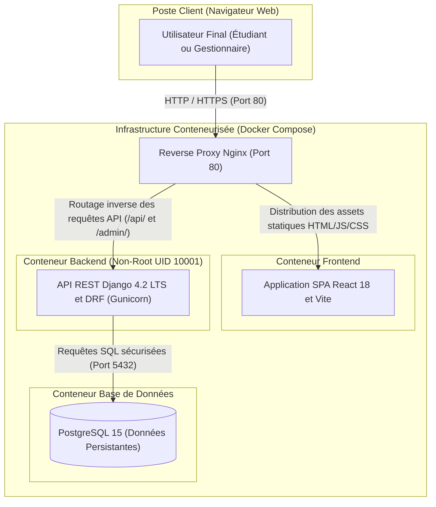
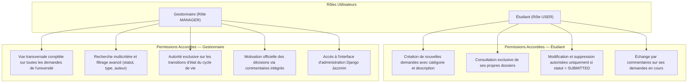
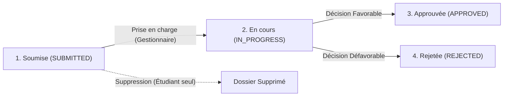
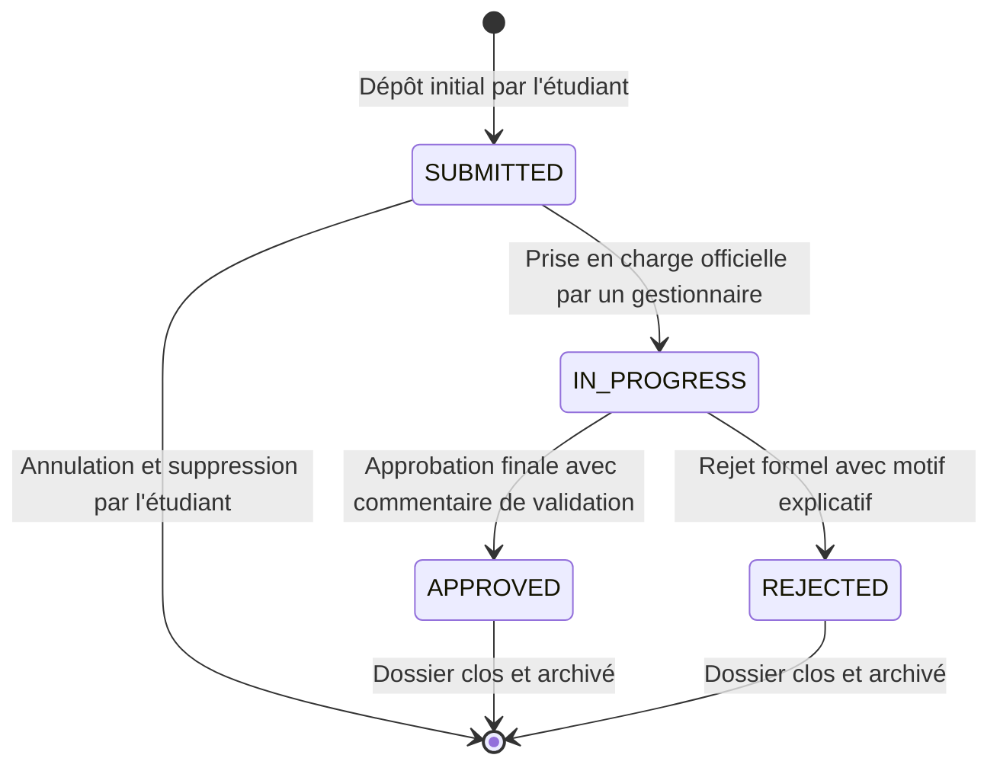
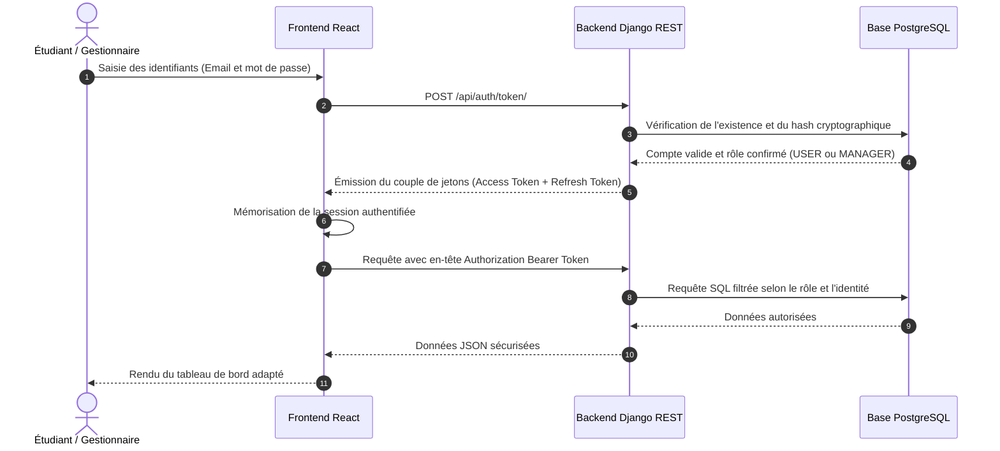

# UQO-Requests — Plateforme Centralisée de Gestion des Demandes

Projet académique développé dans le cadre du cours **INF1743 — Développement d'applications web**  
**Institution :** Université du Québec en Outaouais (UQO)  
**Département :** Département d'informatique et d'ingénierie  
**Session :** Hiver 2026  
**Licence :** MIT

---

## 1. Description du Projet

### Contexte & Vision

Au sein d'un établissement d'enseignement supérieur comme l'**Université du Québec en Outaouais (UQO)**, les interactions entre la communauté étudiante et les services administratifs et pédagogiques constituent un pilier central de la réussite universitaire. 

Historiquement, le traitement des demandes particulières (révision de notes, conflits d'horaires d'examens, dérogations de préalable, requêtes d'accès aux infrastructures de recherche, attestations officielles) reposait sur des processus hétérogènes : formulaires papier, échanges de courriels informels ou démarches en personne auprès des secrétariats. Ces canaux traditionnels présentent des limites majeures : risques de perte de dossiers, absence de visibilité en temps réel pour l'étudiant, manque de traçabilité des décisions et surcharge administrative pour le personnel enseignant et de gestion.

**UQO-Requests** répond à cette problématique en offrant une **plateforme web centralisée, moderne et hautement sécurisée**. Elle standardise l'ensemble du cycle de vie des requêtes, garantit une équité de traitement grâce à une piste d'audit certifiée, et instaure un canal de communication direct et transparent entre demandeurs et décideurs.

---

### Objectifs Principaux

- **Centralisation du guichet unique :** Rassembler en une interface unifiée l'ensemble des typologies de demandes académiques, administratives et techniques.
- **Transparence et suivi en temps réel :** Permettre à chaque étudiant de suivre l'état d'avancement exact de ses requêtes (tableau de bord dynamique, alertes de changement de statut).
- **Rigueur décisionnelle et intégrité :** Imposer une machine à états finis inviolable garantissant qu'aucune demande ne puisse être clôturée ou altérée sans validation humaine explicite et motivée.
- **Piste d'audit et conformité :** Consigner automatiquement chaque transition d'état avec l'identité de l'agent responsable, les valeurs d'état avant/après et un horodatage officiel côté serveur.
- **Communication contextuelle intégrée :** Intégrer un espace de dialogue par commentaires au sein de chaque dossier, éliminant les pertes d'information dispersées par messagerie externe.
- **Sécurité de niveau institutionnel :** Appliquer une architecture Fail-Secure avec contrôle d'accès strict basé sur les rôles (RBAC), isolation par conteneurs et conformité au standard Zéro-Vulnérabilité.

---

### Typologie des Demandes Prises en Charge

| Catégorie | Code Métier | Exemples Concrets |
| :--- | :--- | :--- |
| **Académique** | `ACADEMIC` | Demande de révision de note d'examen, demande de report pour conflit d'horaire, demande de dispense de préalable, validation d'équivalence de crédits. |
| **Administratif** | `ADMINISTRATIVE` | Émission d'attestation d'inscription officielle, modification de programme d'études, demande de relevé de notes certifié, régularisation de dossier. |
| **Technique** | `TECHNICAL` | Attribution de quotas sur les serveurs de calcul intensif, accès physique aux laboratoires de robotique, licence pour logiciels spécialisés. |
| **Général** | `OTHER` | Renseignements généraux, médiation facultaire, demandes particulières transmises aux services de la vie étudiante. |

---

## 2. Architecture Globale du Système

Le système est conçu selon une architecture logicielle découplée orientée micro-services, garantissant haute disponibilité, isolation des responsabilités et étanchéité des couches applicatives.

### Schéma d'Architecture et Déploiement



### Description des Couches

- **Couche Présentation (Frontend) :** Single Page Application développée avec **React 18** et **Vite**. Routage déclaratif via **React Router 6**, design system adaptatif (mode clair / sombre) et communication asynchrone sécurisée par **Axios**.
- **Couche Métier (Backend API) :** Service RESTful propulsé par **Python 3.11**, **Django 4.2 LTS** et **Django REST Framework (DRF)**. Intègre l'administration avancée personnalisée avec **Jazzmin**.
- **Couche Persistance (Base de Données) :** **PostgreSQL 15** assurant l'intégrité référentielle, le verrouillage des transactions concurrentes et la traçabilité des historiques.
- **Couche Passerelle & Sécurité (Reverse Proxy) :** **Nginx Alpine** configuré pour l'injection stricte des en-têtes HTTP de sécurité, la compression Gzip et l'isolation réseau inter-conteneurs.

---

## 3. Matrice de Contrôle d'Accès (RBAC)

La sécurité applicative repose sur un contrôle d'accès strict basé sur les rôles. Le backend Django est la seule autorité d'évaluation des permissions : aucune décision critique n'est déléguée au client.



---

## 4. Cycle de Vie d'une Demande (Machine à États)

Toute demande suit une machine à états finis stricte. Toute tentative de saut d'état illégal ou non autorisé par l'acteur déclenche une exception de validation et un rejet immédiat par l'API REST.





### Règles de Gestion Invariants

1. **Règle d'immuabilité étudiante :** Dès qu'une demande bascule au statut `IN_PROGRESS`, elle devient strictement non modifiable et non supprimable par l'étudiant.
2. **Piste d'audit automatique :** Chaque transition génère un enregistrement immuable dans la table `StatusHistory` consignant l'ancien statut, le nouveau statut, l'identifiant de l'agent et l'horodatage exact.
3. **Motivation obligatoire :** Toute clôture (`APPROVED` ou `REJECTED`) est accompagnée d'un commentaire d'explication destiné à l'étudiant.

---

## 5. Flux d'Authentification Sécurisée (JWT)

L'authentification s'appuie sur le protocole JSON Web Token avec rotation et invalidation des jetons de rafraîchissement.



---

## 6. Sécurité & Conformité DevSecOps

Le projet applique le **Protocole d'Exécution Zéro-Vulnérabilité** :

- **Zéro Secret en Dur :** Aucun mot de passe, clé secrète ou identifiant d'infrastructure n'est présent dans le code source ou la documentation.
- **Fail-Secure par Conception :** Si la variable `SECRET_KEY` est omise en environnement de production (`DEBUG=False`), le serveur refuse immédiatement de démarrer.
- **Protection Anti-Brute Force :** *Throttling* applicatif sur les endpoints d'authentification (`AnonRateThrottle` à 60 req/min, `UserRateThrottle` à 200 req/min).
- **Conteneurs Sécurisés Non-Root :** L'image Docker du backend s'exécute sous un utilisateur dédié sans privilèges d'administration (`appuser`, UID 10001).
- **Builds Docker Multi-Stage :** Les compilateurs C (`gcc`) et bibliothèques de compilation sont exclus de l'image finale de production.
- **En-têtes HTTP de Sécurité :** Injection systématique de `X-Frame-Options`, `X-Content-Type-Options: nosniff` et `Referrer-Policy: strict-origin-when-cross-origin`.
- **Intégrité CI/CD :** Pipeline GitHub Actions automatisant l'audit de dépendances, l'analyse statique de code et la validation des images conteneurisées.

---

## 7. Démarrage Rapide avec Docker

### Prérequis
- [Docker](https://docs.docker.com/get-docker/) et [Docker Compose](https://docs.docker.com/compose/) installés sur votre poste.

### 1. Cloner le dépôt et configurer l'environnement
```bash
git clone https://github.com/fadelilyas01/UQO-Request.git
cd UQO-Request

# Copier le fichier d'exemple et définir vos variables sécurisées
cp .env.example .env
```

### 2. Démarrer en Mode Production
```bash
docker-compose up --build -d
```
L'application est immédiatement accessible :
- Application Web : http://localhost
- API REST : http://localhost/api/
- Administration Django : http://localhost/admin/

### 3. Démarrer en Mode Développement (Hot Reload)
```bash
docker-compose -f docker-compose.dev.yml up --build
```
- Frontend Vite (HMR) : http://localhost:5173
- Backend API (Debug) : http://localhost:8000

---

## 8. Installation Manuelle Locale (Sans Docker)

### Déployer le Backend localement

```bash
cd backend

# 1. Créer et activer l'environnement virtuel
python -m venv venv
# Windows :
.\venv\Scripts\activate
# Linux / macOS :
source venv/bin/activate

# 2. Installer les dépendances
pip install -r requirements.txt

# 3. Configurer les variables d'environnement
cp .env.example .env

# 4. Appliquer les migrations de schéma
python manage.py migrate

# 5. (Optionnel) Initialiser des données de test locales
python manage.py create_demo_data

# 6. Démarrer le serveur API
python manage.py runserver
```

### Déployer le Frontend localement

```bash
cd frontend

# 1. Installer les dépendances avec package-lock vérifié
npm ci

# 2. Démarrer le serveur de développement Vite
npm run dev
```

---

## 9. Catalogue des Points de Terminaison API (Endpoints)

| Méthode | Route | Description | Accès Requis |
| :--- | :--- | :--- | :--- |
| `POST` | `/api/auth/token/` | Obtention du couple de jetons JWT (access et refresh) | Public |
| `POST` | `/api/auth/token/refresh/` | Renouvellement du jeton d'accès expiré | Public |
| `POST` | `/api/auth/register/` | Inscription d'un nouvel utilisateur régulier | Public |
| `GET` / `PATCH` | `/api/auth/profile/` | Consultation et mise à jour du profil utilisateur | Authentifié |
| `POST` | `/api/auth/change-password/` | Mise à jour sécurisée des identifiants d'accès | Authentifié |
| `GET` / `POST` | `/api/requests/` | Liste des demandes de l'utilisateur / Création d'une demande | Authentifié |
| `GET` / `PATCH` | `/api/requests/{id}/` | Consultation / Modification d'une demande au statut initial | Propriétaire |
| `DELETE` | `/api/requests/{id}/` | Suppression définitive d'une demande au statut `SUBMITTED` | Propriétaire |
| `POST` | `/api/requests/{id}/change-status/` | Transition du cycle de vie d'une demande | `MANAGER` |
| `GET` / `POST` | `/api/requests/{id}/comments/` | Consultation et ajout de commentaires contextuels | Autorisé |
| `GET` | `/api/manager/requests/` | Vue transversale supervisée avec filtres multicritères | `MANAGER` |

---

## 10. Commandes Utiles (Makefile)

Un `Makefile` est fourni à la racine pour standardiser les opérations de routine :

| Commande | Action |
| :--- | :--- |
| `make dev` | Démarrer l'environnement de développement avec rechargement à chaud |
| `make dev-build` | Reconstruire les images et démarrer en développement |
| `make prod` | Démarrer la stack de production conteneurisée en arrière-plan |
| `make prod-logs` | Consulter les journaux d'exécution en temps réel |
| `make stop` | Arrêter l'ensemble des conteneurs |
| `make clean` | Purger les conteneurs, réseaux et volumes non persistants |

---

## 11. Licence & Mentions

Ce projet a été réalisé à des fins pédagogiques et académiques pour le département d'informatique et d'ingénierie de l'**Université du Québec en Outaouais (UQO)**.  
Distribué sous licence MIT.
